# ProntoEquip Internal — Equipment Operations Case Study

An Android application for registering equipment, recording checkout and return, and reviewing the evidence behind each movement. This presentation describes a **private application** through a read-only implementation review and reviewed owner-supplied operational screenshots. It does not distribute the application or offer a hosted demo. The developer confirms that the application is in regular internal use every workday; this usage statement has not been independently audited.

## The operational problem

Equipment operations need consistent answers to practical questions: What is available? What is with a customer? What came back needing review? Which photos and records explain a movement?

ProntoEquip Internal brings equipment identity, movement records and supporting evidence into one mobile workflow. Its intended users are internal operators handling equipment and administrators maintaining equipment and type records. The developer confirms that the team uses all operational workflows every workday. User counts, operational volume and measured outcomes are not provided.

## Implemented workflows

The following are present in the reviewed application code. Their inclusion is not a claim that every path was run during this review.

| Workflow | Implemented behavior |
| --- | --- |
| Sign in | Email/password authentication, remote user-profile checks, ADMIN/OPERATOR roles, persistent session storage and local logout. |
| Check availability | Dashboard counts for active equipment: total, available, rented and under review. Selecting a count opens the corresponding equipment filter. |
| Find and register equipment | Search by internal number/type; register an equipment type, internal number and optional brand/notes; inspect details and private equipment photos. Administrators have additional maintenance controls. |
| Identify with NFC | Read an opaque tag token, resolve the associated equipment, bind or replace a tag, and verify a write by reading it back. Manual lookup provides a separate path. |
| Record checkout | Select equipment, enter customer/document details, stage categorized photos and submit through a server-authorized movement operation. Customer confirmation and drawn-signature handling are also implemented. |
| Record return | Select rented equipment, record return evidence and choose available or under review. A separate authorized completion action can return reviewed equipment to available. |
| Recover interrupted work | Save and restore movement drafts, staged photos and pending NFC work. Retry is explicit; restoring a draft does not confirm a movement. |
| Review history and reports | Inspect movement history, dated customer/equipment/operator snapshots and private evidence. Generate a local PDF and use Android preview, share or save actions. |

Historical customer search has its own UI, service, tests and database migration, but its documentation marks that migration as **not yet installed remotely**. It is a local implementation, not a verified live feature. User-account administration remains a placeholder, despite its navigation entry. These distinctions matter more than the presence of a menu item.

## Architecture and technologies

The application uses **TypeScript, React Native 0.81 and Expo SDK 54**, with React Navigation for protected routes. Supabase provides Auth, PostgreSQL and private Storage. PostgreSQL migrations implement row-level security and transactional functions for critical operations. Expo SecureStore holds sessions and pending NFC records; Expo SQLite and private device files support drafts and staged evidence. Native integrations include NFC, image processing, signature capture, PDF generation and Android file/share actions.

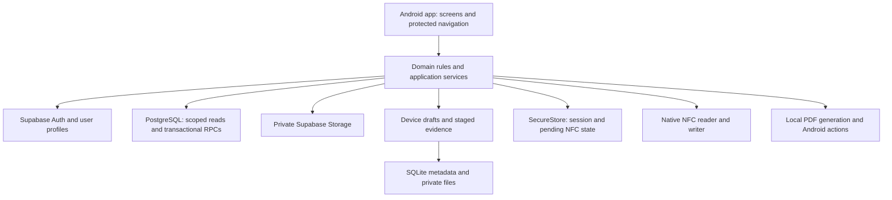

This is a conceptual diagram based on the implementation, not an infrastructure inventory. No service addresses, account identities or operational settings are included. More detail: [implementation decisions](docs/IMPLEMENTATION.md).

## Decisions and challenges

- **A saved draft is not a completed operation.** The server remains authoritative. Submission rechecks equipment state and retains an operation identity for safe explicit retry.
- **Photos and status changes must agree.** Evidence preparation, upload and finalization have separate stages; the movement is not presented as complete simply because a local image exists.
- **History should describe the event.** Commit-time snapshots preserve available historical values; missing values in older records are not silently replaced with today's equipment or customer data.
- **Offline support has boundaries.** Local drafts and staged files can survive interruption, but authentication and equipment-catalog access still require connectivity. There is no automatic background movement synchronization.
- **Private evidence needs a lifecycle.** Authenticated access, temporary photo URLs, scoped PDF cache cleanup and the distinction between a temporary report and a user-saved copy are explicit parts of the design.

## Development and verification status

The codebase contains operational workflows beyond its older foundation README. Its progress records describe prior Android/NFC, photo, movement, recovery and PDF checks. Those are **historical project records**, not tests repeated or independently witnessed for this presentation. No app, backend, account or physical device was operated during preparation.

## Contribution and daily use

Kevin Bortolini confirms that he developed the entire application. He reports that his team uses all operational workflows every workday in regular internal operations. The application supports their equipment lookup, checkout, return review and evidence retrieval. These authorship and usage statements are supplied by the developer; they are not inferred from repository contents or independently measured. No user counts, time savings, reliability percentages or business outcomes are claimed.

This confirmation does not establish that every screen in the reviewed source is complete: user administration is still a placeholder, and the local customer-search migration has a separate deployment caveat. The current source snapshot and the installed build have not been compared at runtime.

## Remaining limitations

Current limitations include incomplete user administration, the locally implemented customer-search migration, online authentication/catalog dependencies, no automatic background synchronization and no offline historical-photo cache. SQLite and private files are not claimed to be encrypted at rest. Device compatibility, tag behavior, camera permissions, PDF layout and Android sharing require device-specific validation. See [scope and evidence boundaries](docs/STATUS.md).

## Visual walkthrough

These owner-supplied operational application captures were reviewed locally, cropped and redacted with solid opaque masks. They are **not fictional-data demonstrations**. The interface remains in its original Portuguese; captions are English. No translated labels, replacement records, generated imagery or simulated screen layouts were introduced.

All exports are flattened RGB PNGs without metadata. System bars, account/organization identifiers, equipment identifiers, sensitive record metrics/dates and identifying photo content were removed or covered where present. These captures illustrate visible UI only; they do not establish completed operations or NFC, camera, PDF or backend acceptance.

### Dashboard and shortcuts

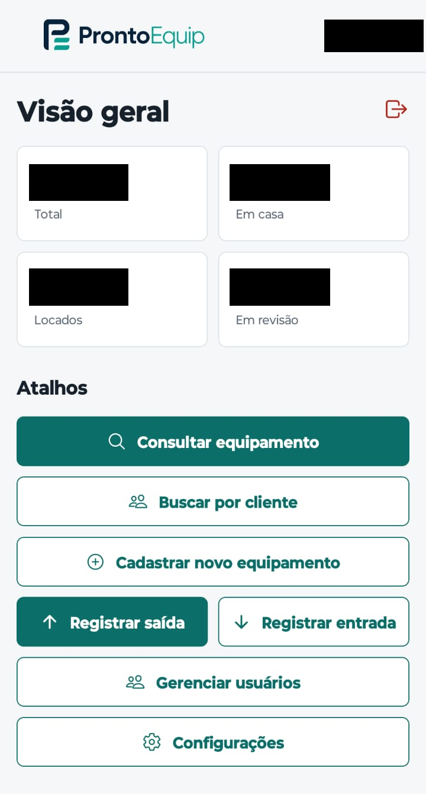

Status categories and operational shortcuts; account identity and inventory counts are masked. **Operational application screenshot; identifying information redacted.**

### Equipment detail and NFC controls

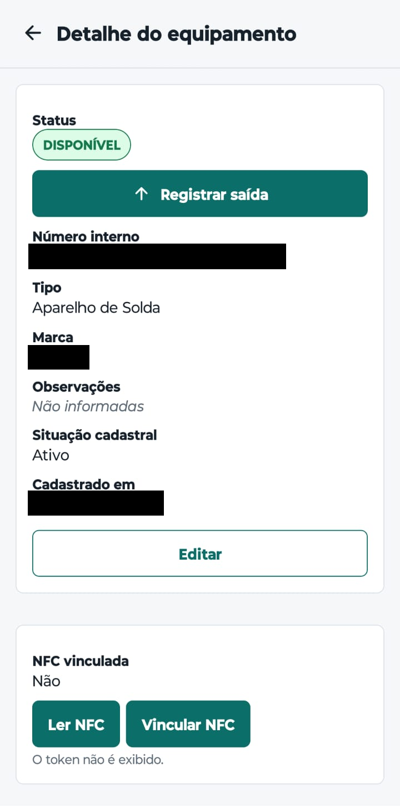

Equipment status, generic type and NFC actions; internal identity, brand value and registration date are masked. **Operational application screenshot; identifying information redacted.**

### Checkout details

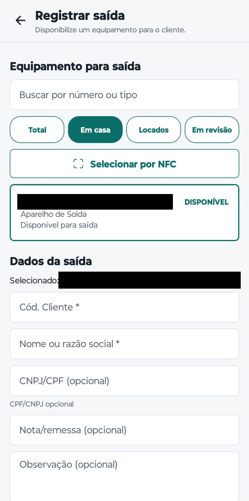

Equipment selection and customer fields before submission; selected-equipment identifiers are masked. **Operational application screenshot; identifying information redacted.**

### Return details

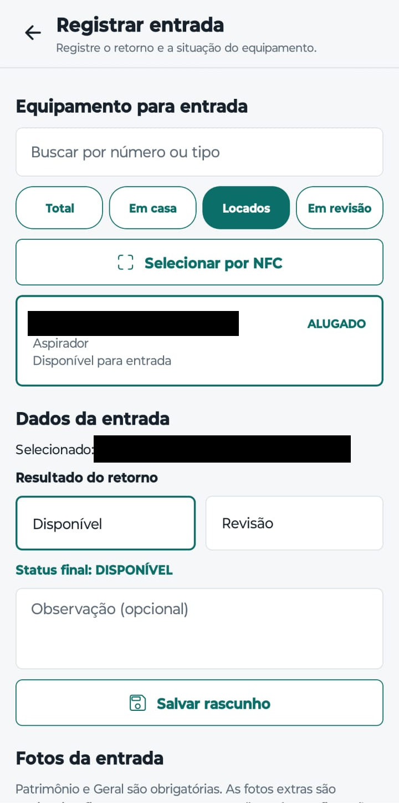

Return outcome options and draft controls; selected-equipment identifiers are masked. No completed return is established by this form. **Operational application screenshot; identifying information redacted.**

Additional reviewed application views

### Equipment lookup

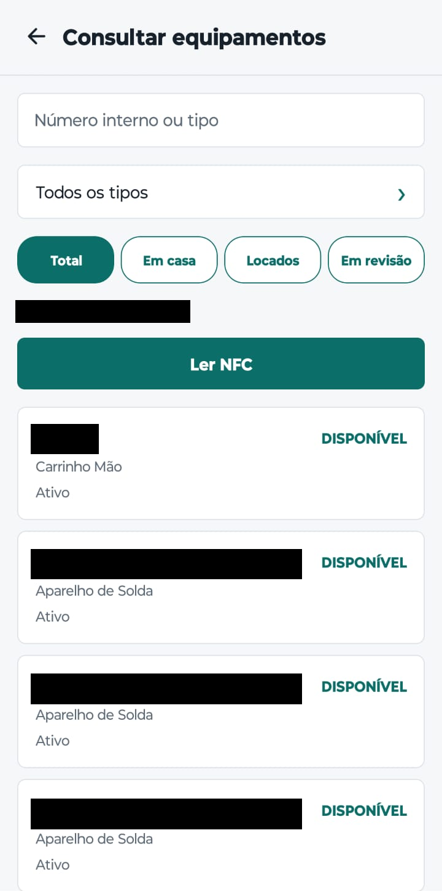

Status filters, manual search and the NFC lookup action; equipment identifiers and the result count are masked. **Operational application screenshot; identifying information redacted.**

### Sign-in screen

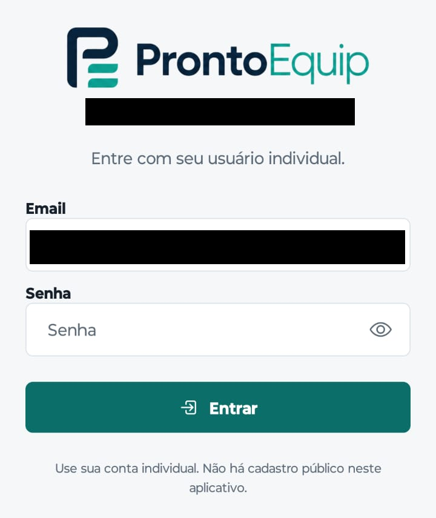

Individual sign-in form; organization text and the account-domain hint are masked. **Operational application screenshot; identifying information redacted.**

### Equipment registration

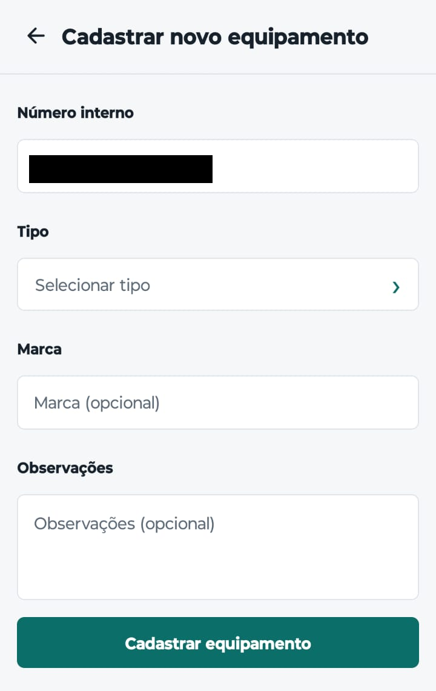

Equipment registration fields before submission; the identifier example is masked. **Operational application screenshot; identifying information redacted.**

### Checkout photo requirements

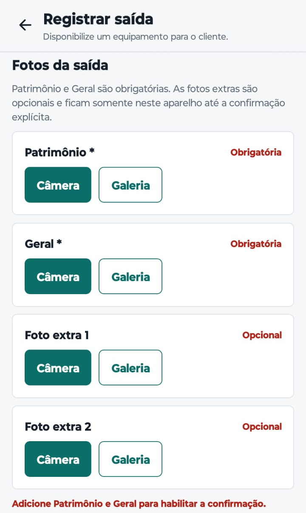

Required and optional evidence categories with camera/gallery actions; no photo has been added in this view. **Operational application screenshot; identifying information redacted.**

### Customer confirmation and draft controls

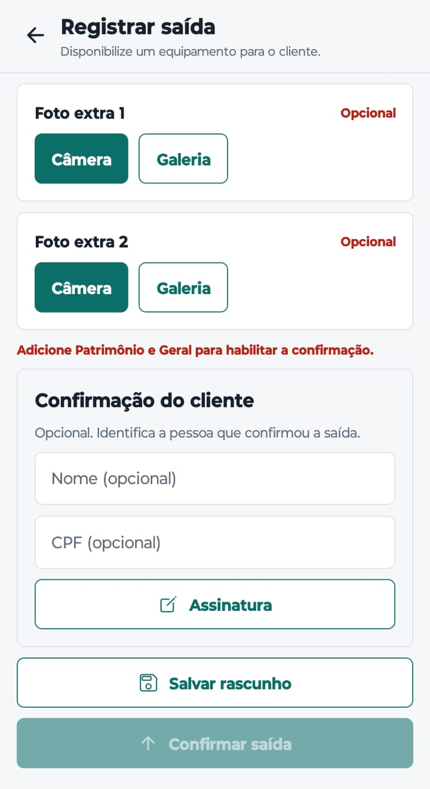

Empty optional confirmation fields and the signature action; checkout confirmation remains disabled. **Operational application screenshot; identifying information redacted.**

### Private photo and history controls

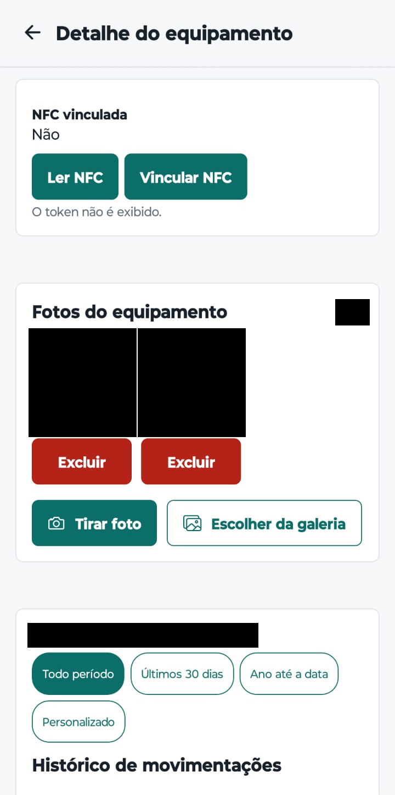

Photo-management and period-filter controls; both thumbnails and record metrics are fully covered. No populated movement event is shown. **Operational application screenshot; identifying information redacted.**

### Return photo requirements

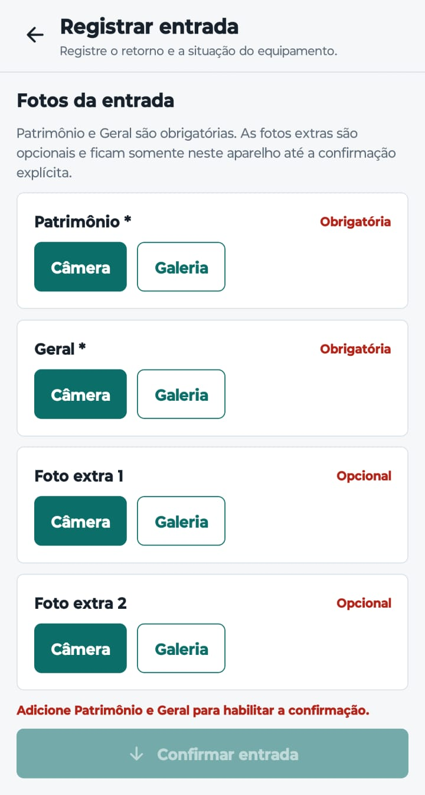

Return evidence categories and disabled confirmation; no photo has been added in this view. **Operational application screenshot; identifying information redacted.**

The [screenshot guide](docs/SCREENSHOT_GUIDE.md) remains available for optional future English captures from an isolated fictional demonstration. It does not describe the provenance of the operational images above.

## What remains private

This folder contains newly written presentation documents and reviewed redacted screenshots only. Application source, Git history, databases, configuration, credentials, operational documents, real photos, customer details and signatures remain private. No application source license is assigned by this case study. Framework and service names identify technologies used, not endorsement; no standalone third-party logo, font or application asset files are redistributed here. Application branding is retained only within the owner-supplied interface captures.
